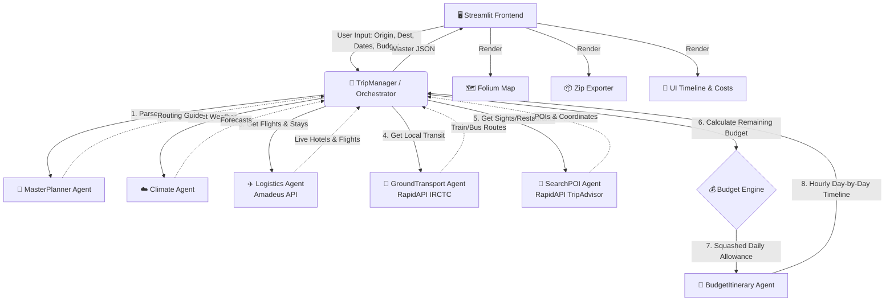

# 🌍 VoyagrBot: The Intelligent Multi-Agent Travel Planner
**A Comprehensive Project & Architecture Guide**

***

## 1. Project Overview
**VoyagrBot** is an advanced, AI-driven travel planning application built using Python and Streamlit. Unlike standard itinerary generators that rely solely on static LLM hallucinations, VoyagrBot uses a **Multi-Agent Architecture** combined with **Real-Time Data APIs** (Amadeus, RapidAPI TripAdvisor/Booking) to synthesize highly accurate, budget-constrained, and interactive travel plans.

It acts as a complete travel concierge—capable of booking logic, dynamic cost scaling, spatial mapping, and multi-day hourly scheduling.

### Key Features
* **Multi-Agent Orchestration:** Specialized AI agents handle distinct roles (Planning, POI Search, Weather, Transport, Budgeting).
* **Real-Time API Integration:** Fetches live flight pricing, train schedules, hotel options, and restaurant/attraction coordinates.
* **Strict Dynamic Budgeting:** Mathematically bounds the generated itinerary to ensure the user's total trip cost never exceeds their specified max budget, actively scaling down daily allowances or injecting budget-fallbacks.
* **Interactive Spatial Maps:** Uses `folium` to plot color-coded, interactive pins for Sights (Blue), Food (Red), and Stays (Green).
* **Exportable Zip Archives:** Generates multi-file `.txt` daily schedule breakdowns dynamically compiled into a downloadable Zip file.
* **Mindtrip-Style Routing:** Deep, step-by-step multimodal transit instructions (Air, Train, Road).

***

## 2. System Architecture & Flow Chart

VoyagrBot utilizes a **Hub-and-Spoke** agentic design. The `TripManager` (Orchestrator) sits at the center, dispatching specific data-gathering tasks to modular sub-agents before compiling the final output.

### The Data Flow:
1. **Input:** The User provides basic parameters on the UI sidebar.
2. **Parsing:** The Orchestrator pings the OpenAIAgent (`MasterPlanner`) to extract exact dates, routing logic, and intent.
3. **Data Harvesting:** Specialized agents ping live APIs in parallel. Weather dictates POI selection (e.g., indoor vs outdoor).
4. **Constraint Math:** The Orchestrator filters Transport and Hotels to find the absolute minimum costs under the user's budget limit.
5. **Timeline Synthesis:** The remaining budget is passed to the `BudgetItineraryAgent`. This agent structures 4 meals a day + events into strict hourly blocks, scaling fallback prices mechanically to ensure the total trip stays under budget.
6. **Delivery:** The UI receives a massive `master_itinerary` JSON and translates it into interactive maps, expanders, tables, and downloadable archives.

***

## 3. Technology Stack
* **Frontend:** Streamlit, Streamlit-Folium (Spatial Maps)
* **Backend Core:** Python 3, `core/orchestrator.py`
* **Agentic LLM Logic:** OpenAI API (`gpt-3.5-turbo`)
* **Real-Time Telemetry:** RapidAPI (TripAdvisor/Booking.com for POIs, IRCTC for Indian Railways)
* **Aviation/Hotel Telemetry:** Amadeus API (Flights/Properties)
* **Data Processing:** `json`, `datetime`, native Python lists/dictionaries.
* **File Operations:** `io.BytesIO`, `zipfile`, `FPDF`

***

## 4. Expected Presentation Questions & Answers

If you are presenting this project, experts will likely test you on edge-cases, architectural choices, and API realities. Here is how to answer them:

### Q1: "Why use a Multi-Agent architecture instead of just sending one giant prompt to ChatGPT?"
**Answer:** "A single giant prompt causes LLM hallucination and context-window bloat. By splitting the app into specialized agents (Logistics, Climate, POI, Budget), we can fetch *deterministic, real-world data* from APIs like Amadeus and TripAdvisor. The LLM is only used for what it is good at: routing logic and synthesizing the final structured JSON. Everything else is grounded in real API data."

### Q2: "How do you guarantee the trip doesn't exceed the user's budget?"
**Answer:** "VoyagrBot uses a strict algorithmic squashing mechanism. First, the Orchestrator forces the maximum transport slice to 40% and hotel slice to 30%. It retrieves the lowest actual prices from those arrays. It then takes `Total Budget - Min Transport - Min Hotel` to find the exact leftover cash. That leftover cash is divided by the number of days to create a `daily_allowance`. The Itinerary generator receives this allowance and mathematically forces all meal and attraction prices to scale perfectly underneath it. If the API returns nothing affordable, the system dynamically injects 'Budget Carrier' fallbacks to prevent the math from crashing."

### Q3: "What happens if an external API (like RapidAPI or Amadeus) fails or times out?"
**Answer:** "The application is built with fault-tolerance. Every single agent wrapper (like `transport_ground.py` or `logistics.py`) has a `try/except` block and a `_fallback_options()` method. If the API key is missing, rate-limited, or times out, the system generates robust mock JSON data that structurally mirrors the API response so the downstream UI and map never crash."

### Q4: "How does the interactive map maintain its state without resetting every time a user clicks a button?"
**Answer:** "Streamlit natively triggers a full script rerun on every interaction. To prevent the Folium map from resetting its zoom or losing markers, I injected the map coordinates and the generated `master_itinerary` directly into `st.session_state`. The UI only re-reads from this cached state, providing a smooth, static feel to the frontend map."

### Q5: "How are the downloadable zip archives generated on the fly without cluttering the server's hard drive?"
**Answer:** "I utilized Python's native `io.BytesIO()` buffer buffer alongside the `zipfile` library. Instead of writing text files to a `/tmp/` directory on the physical disk, the daily schedules are generated entirely in RAM (memory). The Streamlit download button simply streams that in-memory byte buffer directly to the user's browser, keeping the server completely clean."

### Q6: "How do you handle varying locations that don't have accurate API coverage?"
**Answer:** "The system has implicit fallback mapping. For example, if the POI visualizer can't extract exact Latitude/Longitude from the TripAdvisor payload for a specific cafe, it calculates an artificial micro-offset from the main Destination center coordinates so the map pin still renders intelligently near the city."

***

## 5. Which File Does What?

### Main Application
* **`main.py`**: The central Streamlit application file. Handles the user interface (UI), state management, capturing user inputs, displaying the map, timeline, and rendering the final interactive output. It instantiates the `TripManager`.

### Core Logic
* **`core/orchestrator.py`** (or `core/trip_manager.py`): The brain of the operation. The Orchestrator manages the overarching logic, sequentially calling the different sub-agents, handling API fallbacks, enforcing the strict budget constraint logic, and compiling the massive JSON `master_itinerary` structure.
* **`core/utils.py`** or **`core/prompts.py`**: Typically stores shared helper functions (like Zip generation, string parsing) and the massive system prompts for the OpenAI models.

### The Agents (`/agents/` Directory)
* **`agents/master_planner.py`**: Analyzes the raw user inputs. Determines the geographical routing, how many days the trip spans, and formats the core logistical spine.
* **`agents/logistics.py`**: Interfaces with the Amadeus API to fetch real-world Flights and Hotels. Filters them for cheapest/direct options depending on budget constraints.
* **`agents/transport_ground.py`**: Responsible for domestic/local transit. Fetches real-world intercity Train or Bus data (e.g., using RapidAPI IRCTC or similar endpoints) for journeys between locations that don't need flights.
* **`agents/search_poi.py`**: Interfaces with TripAdvisor/Booking/Google APIs via RapidAPI to fetch lists of Sights (Attractions), Restaurants, and local Activities, along with their coordinates (Lat/Long).
* **`agents/climate.py`** (if applicable): Checks the weather for the chosen dates and passes context to other agents (e.g., suggesting indoor activities if it's raining).
* **`agents/budget_itinerary.py`**: Takes the squashed remaining budget (after flights and hotels) and mathematically forces daily activities and 4 meals/day to fit perfectly under the daily allowance, returning structured hourly plans.
* **`agents/fallback.py`**: A vital safety net. Contains hardcoded structural JSON payloads. If external APIs timeout or fail, the fallback agent injects realistic artificial data so the UI doesn't crash.

***

## 6. The Agents Used & What They Expose

1. **MasterPlanner Agent**: The "Director". Instructs the rest of the cast on what kind of trip to structure based on user constraints.
2. **Logistics Agent**: Exposes flight routes, minimum airfare, hotel names, star ratings, and minimum nightly hotel costs.
3. **SearchPOI Agent**: Exposes rich arrays of Local Attractions, Nightlife, Lunch Spots, and Dinner options, including visual data (source URLs, latitudes, longitudes).
4. **GroundTransport Agent**: Exposes ground/rail travel options between cities, preventing the app from hallucinating flights between neighboring towns.
5. **BudgetItinerary Agent**: The "Accountant & Scheduler". Exposes the precise multi-day array detailing the hour-by-hour schedule, confirming the budget maths checks out.

***
